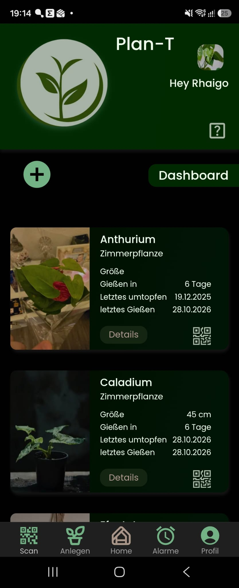

# Plan-T

Welcome to Plan-T, a progressive web application designed to help plant enthusiasts effortlessly track, care for, and optimize their plant collection. In the hustle of everyday life, it's easy to lose track of regular watering schedules, miss repotting deadlines, or forget individual care requirements. With Plan-T, my goal is to tackle this issue and make plant care organized, automated, and effortless.

## Table of Contents
- [Features](#features)
- [Highlights](#highlights)
  - [Automatic Plant Recognition and Creation](#automatic-plant-recognition-and-creation)
  - [Setting Alarms and Receiving Push Notifications](#setting-alarms-and-receiving-push-notifications)
- [Deployment](#deployment)
- [Tech Stack](#tech-stack)

## Features

You can use Plan-T to:

- Identify plants automatically by uploading a photo via an integrated AI and n8n webhook workflow
- Add and manage plants with care details (watering intervals, last watering date, repotting intervals, plant size, and procurement history)
- Set up smart recurring watering alarms that automatically suggest the next date based on the plant's watering interval and last watering date
- Receive Web Push notifications directly on desktop and mobile devices when your plants need water
- Generate, download, and print QR code plant labels (PDF) for physical plant pots
- Scan QR codes with your device's camera to instantly open and view a plant's profile
- Track total collection metrics, including the number of plants and overall plant purchase costs
- Securely log in using email/password credentials or Google OAuth (protected by IP-based rate limiting)
- Install and use Plan-T as a Progressive Web App (PWA) with offline capabilities

While the app is still under active development, you can already get a glimpse of its direction and explore its core features.

Thank you for taking the time to explore Plan-T!

## Highlights

### Automatic Plant Recognition and Creation

### Setting Alarms and Receiving Push Notifications

## Deployment

Check out the latest update of Plan-T on Vercel: [Plan-T](https://plan-t-app.vercel.app/)

## Tech Stack

- React
- Next.js
- JavaScript
- Styled Components
- Framer Motion
- SWR
- MongoDB
- Mongoose
- NextAuth.js
- AWS S3
- Web Push & Service Worker (PWA)
- n8n (AI Webhook Automation)
- QR Code Scanner & PDF Generation
- Rate Limiting (rate-limiter-flexible)
- Git

The app is a work in progress, and your feedback is highly appreciated as we continue to refine and enhance its features. Thank you for your support!
